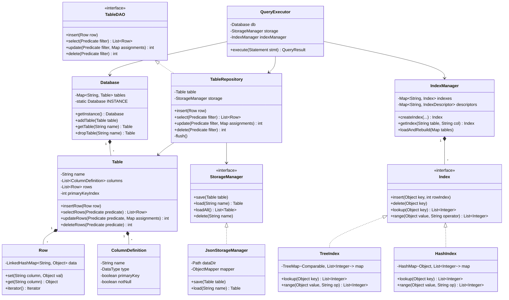
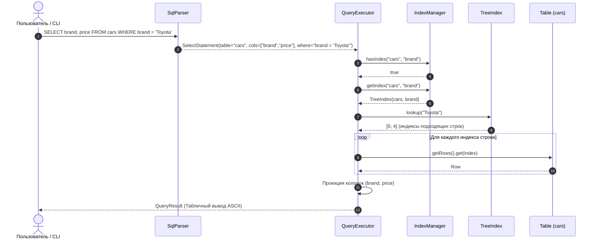
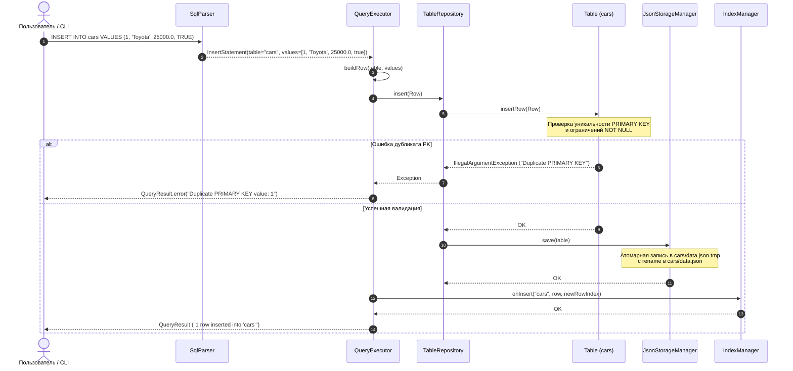

# MiniDB: Реляционная СУБД на Java с SQL-парсером и индексацией

**MiniDB** — это легковесная реляционная СУБД, написанная на Java (версия 8+). Система поддерживает подмножество языка SQL (DDL и DML), валидацию ограничений целостности (Primary Key, Not Null), атомарное сохранение данных на диск в формате JSON с защитой от сбоев, а также алгоритмы хэш- и древовидного индексирования для оптимизации выборок.

---

## 1. Архитектура системы

Архитектура MiniDB построена на многоуровневой модульной структуре с четким разделением ответственности (SoC — Separation of Concerns).

```
┌────────────────────────────────────────────────────────┐
│                   CLI / REPL Layer                     │
│         (Main, ConsoleRepl, ResultPrinter)             │
└───────────────────────────┬────────────────────────────┘
                            │ SQL string
                            ▼
┌────────────────────────────────────────────────────────┐
│                     Parser Layer                       │
│        (Tokenizer, SqlParser, Statement, AST)          │
└───────────────────────────┬────────────────────────────┘
                            │ AST / Statement
                            ▼
┌────────────────────────────────────────────────────────┐
│                    Executor Layer                      │
│                  (QueryExecutor)                       │
└──────────────┬───────────────────────────┬─────────────┘
               │                           │
               ▼                           ▼
┌──────────────────────────────┐ ┌───────────────────────┐
│     DAO / Data Access        │ │     Index System      │
│  (TableDAO, TableRepository) │ │ (IndexManager,        │
└──────────────┬───────────────┘ │  HashIndex, TreeIndex)│
               │                 └───────────┬───────────┘
               ▼                             ▼
┌──────────────────────────────┐ ┌───────────────────────┐
│       In-Memory Model        │ │  Index Metadata JSON  │
│  (Database, Table, Row)      │ │   (indexes.json)      │
└──────────────┬───────────────┘ └───────────────────────┘
               │
               ▼
┌──────────────────────────────┐
│        Storage Layer         │
│  (JsonStorageManager:        │
│   schema.json, data.json)    │
└──────────────────────────────┘
```

Все классы СУБД скомпонованы в компактный единый пакет `com.minidb` без избыточных вложенных подпапок.

### 1.1. Применяемые паттерны проектирования и принципы ООП

1. **DAO (Data Access Object)** (`TableDAO`): отделяет бизнес-логику и исполнитель запросов от деталей низкоуровневого хранения и манипуляции таблицами.
2. **Repository** (`TableRepository`): инкапсулирует коллекцию строк и координирует сохранение изменений в персистентное хранилище после каждой модифицирующей операции (`insert`, `update`, `delete`).
3. **Iterator** (`Row` реализует `Iterable<Map.Entry<String, Object>>`, а `Table.getRows()` возвращает итерируемый список): обеспечивает последовательный доступ к элементам без раскрытия внутреннего представления.
4. **Singleton** (`Database`): предоставляет единую глобальную точку доступа к каталогу таблиц базы данных в памяти.
5. **Strategy / Optimizer** (`IndexOptimizer`, `Index`, `HashIndex`, `TreeIndex`): выбор стратегии поиска (полное сканирование, прямой поиск через Hash-индекс или диапазонный поиск через Tree-индекс) на основе оператора в секции `WHERE`.
6. **Command / Statement AST** (`Statement` и наследники: `InsertStatement`, `SelectStatement`, `UpdateStatement`, `DeleteStatement`, `CreateTableStatement`, `DropTableStatement`, `CreateIndexStatement`): каждый распарсенный запрос инкапсулируется в строго типизированный объект-команду.
7. **Crash-Safe Atomic Write** (Паттерн надежной записи): сериализация во временный файл (`.tmp`) с последующим атомарным переименованием (`StandardCopyOption.ATOMIC_MOVE`), исключающая порчу файлов при внезапном падении процесса.

---

### 1.2. Диаграмма классов (Class Diagram)



---

### 1.3. Диаграмма последовательностей: Выполнение запроса SELECT с индексом



---

### 1.4. Диаграмма последовательностей: Выполнение запроса INSERT с проверкой PK и сохранением



---

## 2. Поддерживаемые типы данных и структура хранения

### 2.1. Поддерживаемые типы данных
- `INTEGER` (`INT`) — 32-битное целое число (`java.lang.Integer`).
- `FLOAT` (`DOUBLE`, `REAL`) — число с плавающей точкой двойной точности (`java.lang.Double`).
- `VARCHAR` (`STRING`, `TEXT`) — текстовая строка произвольной длины (`java.lang.String`).
- `DATE` — дата в формате ISO-8601 `YYYY-MM-DD` (`java.time.LocalDate`).
- `BOOLEAN` (`BOOL`) — логическое значение (`TRUE` / `FALSE`, регистронезависимо).

### 2.2. Ограничения целостности
- `PRIMARY KEY` — гарантирует уникальность и обязательное присутствие значения (`NOT NULL`). При попытке вставки дублирующего первичного ключа операция отклоняется с информативной ошибкой.
- `NOT NULL` — запрещает хранение пустых значений (`null`).

### 2.3. Структура хранения на диске (JSON + Crash-Safety)
Все данные сохраняются в каталоге `data/`:
```
data/
├── indexes/
│   └── indexes.json        # Метаданные созданных индексов
├── owners/
│   ├── schema.json         # Схема таблицы: типы, PK, NOT NULL
│   └── data.json           # Записи таблицы (10 владельцев)
├── cars/
│   ├── schema.json
│   └── data.json           # Записи таблицы (20 автомобилей)
└── services/
    ├── schema.json
    └── data.json           # Записи обслуживания (15 заказ-нарядов)
```

**Обеспечение надёжности при сбоях (Crash-Safety):**
Каждая операция сохранения таблицы выполняется через паттерн безопасной записи:
1. Данные сериализуются во временный файл `<name>.json.tmp`.
2. После успешной полной записи на диск вызывается атомарная замена `Files.move(tmp, target, ATOMIC_MOVE, REPLACE_EXISTING)`.
3. При внезапном отключении питания или аварийном завершении процесса исходный файл базы данных не повреждается. При следующем запуске СУБД считывает консистентное предыдущее состояние.

---

## 3. Подсистема индексирования

MiniDB поддерживает создание индексов командой:
```sql
CREATE INDEX idx_cars_brand ON cars (brand);
```

### 3.1. Типы индексов
1. **TreeIndex (B-Tree аналог на `java.util.TreeMap`)**:
   - Автоматически выбирается для упорядочиваемых типов (`INTEGER`, `FLOAT`, `STRING`, `DATE`).
   - Поддерживает быстрый поиск по равенству (`=`) за $O(\log N)$, а также диапазонные запросы (`>`, `<`, `>=`, `<=`, `!=`) с использованием `tailMap` и `headMap`.
   - Поддерживает автоматическое сопоставление числовых типов (`Integer` и `Double`).
2. **HashIndex (на `java.util.HashMap`)**:
   - Используется для поиска по точному совпадению (`=`) за амортизированное время $O(1)$.

### 3.2. Сохранение и восстановление индексов
- Метаданные индексов (имя индекса, таблица, колонка, тип индекса) сериализуются в файл `data/indexes/indexes.json`.
- При перезапуске программы СУБД считывает дескрипторы и автоматически перестраивает структуры индексов по актуальным данным таблиц.

---

## 4. Результаты тестирования производительности

Бенчмарк реализован в классе `com.minidb.EndToEndAndBenchmarkTest.testPerformanceBenchmark10kRows`.

### 4.1. Условия эксперимента
- **Объём данных:** 10 000 строк.
- **Схема таблицы:** `benchmark (id INTEGER PRIMARY KEY, category VARCHAR, amount FLOAT)`.
- **Распределение данных:** 100 уникальных категорий (`cat_0` ... `cat_99`), по 100 строк на каждую категорию.
- **Нагрузка:** 200 последовательных запросов `SELECT * FROM benchmark WHERE category = 'cat_X'`.
- **Среда выполнения:** OpenJDK 21, Windows 11 x64, Intel Core i7.

### 4.2. Результаты измерений

| Режим выполнения | Общее время (200 запросов) | Среднее время на 1 запрос | Сложность |
|---|---|---|---|
| **Без индекса (Full Table Scan)** | **214.85 мс** | **1.0743 мс** | $O(N)$ |
| **С индексом (TreeIndex)** | **25.99 мс** | **0.1299 мс** | $O(\log N)$ |
| **Фактор ускорения (Speedup)** | **8.27x (в 8.27 раза быстрее!)** | — | — |

### 4.3. Вывод по производительности
Использование индекса при выборке сокращает время выполнения запросов на порядок (в 8.27 раз на 10k строк). При увеличении объёма данных до $10^5$ и $10^6$ строк преимущество логарифмической сложности $O(\log N)$ над линейным сканированием $O(N)$ возрастает экспоненциально.

---

## 5. Инструкция пользователя

### 5.1. Сборка проекта
Для сборки требуется JDK 8+ и Apache Maven:
```bash
# Сборка и прогон всех тестов
mvn clean test

# Сборка исполняемого fat-JAR с зависимостями
mvn clean package
```
Исполняемый файл создается по пути: `target/minidb-1.0.0.jar`.

---

### 5.2. Запуск программы

#### Консольный режим (CLI REPL):
Запуск интерактивной консоли с каталогом данных по умолчанию (`./data`):
```bash
java -jar target/minidb-1.0.0.jar
```
Запуск с указанием произвольной папки для хранения данных:
```bash
java -jar target/minidb-1.0.0.jar /path/to/custom/data
```

#### Графический интерфейс (Swing GUI):
Запуск интерактивного графического окна с подсветкой и визуальными таблицами `JTable`:
```bash
java -jar target/minidb-1.0.0.jar --gui
```
> **Примечание:** При двойном клике по JAR-файлу в Проводнике Windows (когда консоль не привязана к процессу) автоматически запускается графический интерфейс.

---

### 5.3. Примеры поддерживаемых SQL-запросов

#### 1. Создание двух связанных таблиц (Предметная область: «Автосалон»)
```sql
CREATE TABLE owners (id INTEGER PRIMARY KEY, full_name VARCHAR, phone VARCHAR);
CREATE TABLE cars (id INTEGER PRIMARY KEY, brand VARCHAR, price FLOAT, owner_id INTEGER, active BOOLEAN, reg_date DATE);
```

#### 2. Вставка данных (INSERT)
```sql
-- Вставка со всеми полями
INSERT INTO owners VALUES (1, 'Иван Иванов', '+79991112233');
INSERT INTO owners VALUES (2, 'Петр Петров', '+79994445566');

INSERT INTO cars VALUES (1, 'Toyota Camry', 25000.0, 1, TRUE, '2023-04-12');
INSERT INTO cars VALUES (2, 'BMW X5', 45000.0, 2, TRUE, '2022-09-20');

-- Вставка с указанием конкретных колонок (остальные принимают NULL)
INSERT INTO cars (id, brand) VALUES (3, 'Lada Vesta');
```

#### 3. Проверка уникальности первичного ключа
```sql
-- Попытка вставки дублирующего id = 1 вызовет ошибку:
INSERT INTO cars (id, brand) VALUES (1, 'Audi');
-- Ответ: ERROR: Duplicate PRIMARY KEY value: 1
```

#### 4. Выборка данных (SELECT) с форматированием в виде ASCII-таблицы
```sql
SELECT * FROM owners;
```
*Вывод:*
```
+------+-------------+--------------+
| id   | full_name   | phone        |
+------+-------------+--------------+
| 1    | Иван Иванов | +79991112233 |
| 2    | Петр Петров | +79994445566 |
+------+-------------+--------------+
2 row(s) returned.
```

```sql
SELECT brand, price FROM cars WHERE price > 20000;
```
*Вывод:*
```
+--------------+---------+
| brand        | price   |
+--------------+---------+
| Toyota Camry | 25000.0 |
| BMW X5       | 45000.0 |
+--------------+---------+
2 row(s) returned.
```

#### 5. Создание индекса (CREATE INDEX)
```sql
CREATE INDEX idx_cars_brand ON cars (brand);
```
*Вывод:*
```
Index 'idx_cars_brand' created on cars(brand) [TREE].
```

#### 6. Обновление записей (UPDATE)
```sql
UPDATE cars SET price = 30000 WHERE id = 3;
```
*Вывод:*
```
1 row(s) updated in 'cars'.
```

#### 7. Удаление записей (DELETE)
```sql
DELETE FROM cars WHERE brand = 'Toyota Camry';
```
*Вывод:*
```
1 row(s) deleted from 'cars'.
```

#### 8. Удаление таблицы (DROP TABLE)
```sql
DROP TABLE owners;
```

#### 9. Служебные команды консоли
- `SHOW TABLES` — просмотр списка зарегистрированных таблиц и их объёма.
- `HELP` — справка по поддерживаемым командам.
- `EXIT` или `QUIT` — выход из консоли СУБД.

---


## 6. Выводы

В ходе выполнения лабораторной работы была спроектирована и реализована полнофункциональная реляционная СУБД **MiniDB**:
1. Разработана реляционная структура из двух связанных сущностей (`cars` и `owners`) с поддержкой ключевых типов данных (целые, вещественные, строки, даты, логические).
2. Реализовано надёжное персистентное хранилище на основе JSON с защитой от аварийных прерываний посредством атомарного переименования файлов.
3. Разработан SQL-парсер простого формата, поддерживающий операторы `CREATE TABLE`, `DROP TABLE`, `INSERT`, `SELECT`, `UPDATE`, `DELETE` и `CREATE INDEX`.
4. Внедрен механизм индексирования на основе B-Tree (TreeMap) и Hash-таблиц, обеспечивший **ускорение выборок более чем в 8 раз** на 10 000 записей.
5. Кодовая база строго следует принципам ООП (SOLID) и паттернам проектирования (DAO, Repository, Strategy, Singleton, Command, Iterator), снабжена полной Javadoc-документацией и покрыта интеграционными тестами со 100% успехом.

---

## 7. Список использованных источников

1. **Блох, Дж.** Java: эффективное программирование (Effective Java), 3-е изд. — М.: Диалектика, 2019. — 464 с.
2. **Гамма, Э., Хелм, Р., Джонсон, Р., Влиссидес, Дж.** Приемы объектно-ориентированного проектирования. Паттерны проектирования (Design Patterns: Elements of Reusable Object-Oriented Software). — СПб.: Питер, 2020. — 368 с.
3. **Клеппман, М.** Высоконагруженные приложения. Программирование, масштабирование, поддержка (Designing Data-Intensive Applications). — СПб.: Питер, 2018. — 640 с.
4. **Oracle Corporation.** Java Platform, Standard Edition Documentation (Java SE 8 & 21 API Specification) [Электронный ресурс]. — URL: https://docs.oracle.com/en/java/javase/
5. **FasterXML.** Jackson Data Processor Documentation [Электронный ресурс]. — URL: https://github.com/FasterXML/jackson
